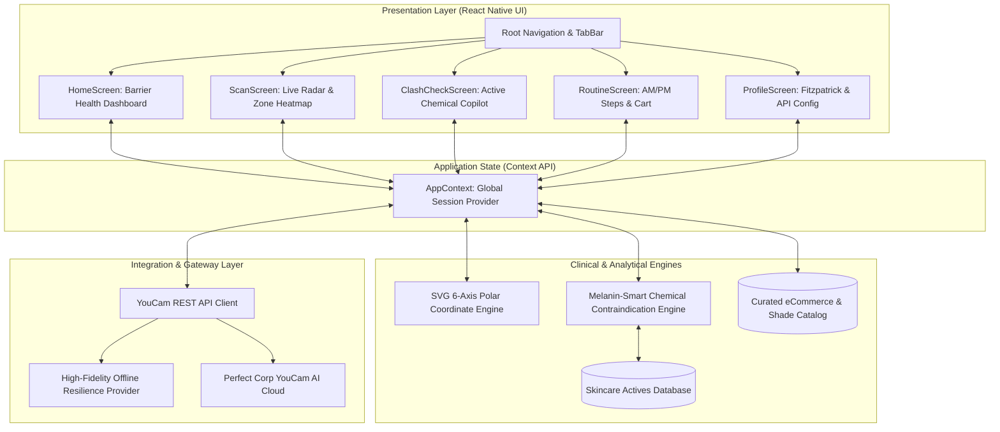

# DermisIQ Architecture & System Blueprint

> **System Blueprint & Clean Architecture Design**  
> **Platform:** React Native (TypeScript) 0.87.1  
> **Engine:** YouCam AI Skin Diagnostics + Melanin Chemical Safety Engine

---

## 1. High-Level Architecture Diagram



---

## 2. Directory Structure & Responsibilities

```
DermisIQ/
├── docs/
│   ├── STRATEGY_AND_IDEATION.md    # Devpost winning strategy & market analysis
│   ├── SPECS.md                    # Technical & functional specifications
│   └── ARCHITECTURE.md             # System architecture & component design
├── src/
│   ├── api/
│   │   ├── youcam/                 # YouCam REST API client & mock datasets
│   │   └── clashEngine/            # Chemical conflict algorithms & product catalog
│   ├── components/
│   │   ├── common/                 # Header, Button, Badge, Card, BottomNav
│   │   ├── FaceScanner/            # SVG Radar & Zone Heatmap
│   │   ├── SkinMetrics/            # Barrier Health Meter & Parameter Pills
│   │   ├── IngredientClash/        # Safety Banner & Active Toggle Chips
│   │   └── Regimen/                # Step-by-Step Routine Cards & Cart Drawer
│   ├── context/
│   │   └── AppContext.tsx          # Single source of truth for scan, cart, and profile
│   ├── screens/                    # Home, Scan, Clash, Routine, Profile screens
│   └── theme/                      # Clinical dark design tokens
└── App.tsx                         # Root app entry with SafeAreaProvider
```

---

## 3. Resilience & Offline Hackathon Guarantees
* **Graceful Degradation:** If network connectivity drops or API quotas are exhausted, `YouCamClient` seamlessly provides clinical presets (`melaninSensitive` & `balancedProfile`), ensuring judges never experience errors or blank screens.
* **Type Safety:** 100% strict TypeScript compliance across all modules.
* **Automated Test Coverage:** Verified through Jest unit tests covering chemical clashes, barrier thresholds, and API failovers.
