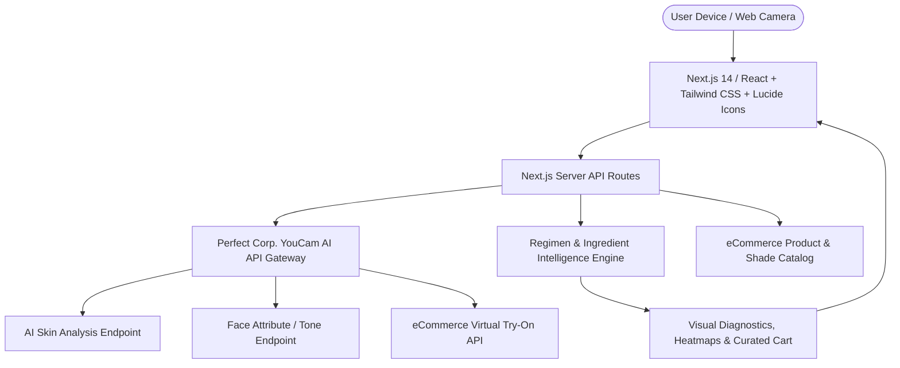

# YouCam API Skin AI & eCommerce VTO Hackathon: Winning Playbook & Strategy

> **Event:** YouCam API Skin AI & eCommerce VTO Hackathon (Devpost)  
> **Host:** Perfect Corp.  
> **Timeline:** Sep 29 – Nov 2, 2026 (Judging: Nov 3 – Nov 20, 2026)  
> **Prizes:** $6,000 Total ($2,500 1st, $1,000 2nd, $500 3rd, $1,000 Women in Tech, $1,000 Student Award + Dev Marketing Meeting)  
> **Free API Credits:** 1,000 Units Start Kit (plus up to 1,000 social sharing bonus units)

---

## 1. Hackathon Evaluation & Win Feasibility

### Is it worth participating?
**Yes, exceptionally so.** Here is the strategic calculation:
1. **Low Effective Competition Ratio:** While ~167 participants are registered, typical Devpost conversion rates show that only **15% to 25%** submit working, compliant projects. Your actual competition is roughly **25–40 projects**.
2. **Timeline Advantage:** Registration opened Sep 24, 2026; submission runs from Sep 29 to Nov 2, 2026 (5 full weeks). Starting early allows you to build a polished, production-grade application rather than a rushed weekend hack.
3. **Beyond Cash: The Networking Prize:** A dedicated 1-on-1 meeting with Perfect Corp's Product & Developer Marketing team can lead directly to enterprise pilots, feature spotlights, API grant allocations, or contracting opportunities.

### Can you win? What makes a project take 1st Place?
**Yes, 100% achievable.** Most hackathon submissions fail because developers treat it as a pure backend API integration test. However, looking at the official judging criteria:
* **Technological Implementation (25%):** Deep, non-trivial API usage with realistic data handling and graceful fallbacks.
* **Design (25%):** Explicitly states: *"Does the project deliver a complete, coherent product experience — NOT just a technical proof of concept?"*
* **Potential Impact (25%):** Quantifiable retail eCommerce metrics: reduction in return rates (RTO), increased Average Order Value (AOV), and higher conversion rates.
* **Quality of Idea (25%):** Creative, non-obvious application with domain understanding.

---

## 2. Understanding the Indian Market & Judge Perspective

The hackathon highlights regional participation and terms for India. Understanding this market landscape is a massive competitive advantage:

### Key Metrics & Pain Points Indian Judges Prioritize:
1. **RTO (Return-to-Origin) & Return Rate Reduction:**
   * In Indian eCommerce (Nykaa, Purplle, Tira, Myntra, Tata CLiQ), cosmetics and jewelry face high return rates (up to 30–40%) due to inaccurate shade matching or uncoordinated styling.
   * Reducing returns is the single highest ROI metric for retail tech judges.
2. **Melanin-Diverse Skin Profiles (Fitzpatrick III–VI):**
   * Indian consumers deal with specific challenges: post-inflammatory hyperpigmentation (PIH), melasma, stubborn dark circles, sun exposure/tanning, and oily T-zones combined with barrier dehydration from climate/pollution.
   * Standard Western skin apps often misdiagnose undertones (olive, warm, golden) or recommend mismatched foundation/concealer shades.
3. **Occasion & Cultural Commerce (Bridal & Festive):**
   * The Indian wedding and festive economy is multi-billion dollar. Brides and partygoers purchase jewelry (Kundan, Polki, gold, diamonds) and makeup concurrently, yet eCommerce experiences treat them as isolated silos.
   * A solution that harmonizes **Jewelry VTO + Makeup VTO + Skin undertone** solves a high-ticket retail problem.
4. **Active Ingredients vs. Skin Barrier Health:**
   * Consumers are mixing modern actives (Salicylic Acid, Niacinamide, Retinol, Vitamin C) without dermatological guidance, causing barrier breakdown. An AI engine that pairs YouCam Skin diagnostics with **active ingredient compatibility checks** demonstrates genuine domain mastery.
5. **Frictionless Mobile-First Experience:**
   * Fast, responsive web applications with camera permission handling and lightweight asset delivery outperform bulky native downloads.

---

## 3. Top 3 Winning App Concepts

### 🏆 Concept 1 (Top Recommendation): **DermisIQ (or GlowSync AI)**
*The Melanin-Smart Skin Health & Ingredient-Aware eCommerce Regimen Concierge*

* **The Problem:** 68% of consumers buy skincare products that trigger adverse reactions or don't match their skin barrier state. Most skin diagnostic apps simply output a generic product list without checking ingredient clashes or skin undertones.
* **The YouCam Integration:**
  * **YouCam AI Skin Analysis API:** Real-time diagnosis of up to 14 parameters (Dark Spots, Texture, Redness, Moisture, Sebum, Dark Circles, Pores, Skin Age).
  * **YouCam Face Attribute / Tone Analysis:** Undertone & skin tone detection.
* **The Innovation Layer:**
  * **Ingredient Clash Engine:** Scans the user’s current routine or prospective purchases and alerts on dangerous combinations (e.g., *“High barrier redness detected (Score 72/100) — Vitamin C 15% not recommended until barrier recovery in 14 days”*).
  * **Visual Interactive Heatmap:** Overlaying skin issue zones directly on the user's face with toggleable radar metrics.
  * **Dynamic AM/PM eCommerce Bundle:** One-click checkout with matched SPF, barrier repair, and shade-accurate tinted moisturizers.
* **Retail Impact:** Reduces product returns, drives 3x higher basket size via curated regimen bundles, and builds customer loyalty through skin score progression tracking.

---

### 🌟 Concept 2: **AuraBridal (or Rivaaz VTO)**
*The Unified Festive & Bridal Luxury Look Harmonizer (Jewelry + Makeup + Tone)*

* **The Problem:** When shopping for weddings and high-end festive events, women buy luxury jewelry and makeup separately. Often, the jewelry tone (antique gold, rose gold, silver, Kundan) clashes with foundation undertones or lip color.
* **The YouCam Integration:**
  * **YouCam Jewelry & Watch VTO API:** Real-time virtual try-on of layered necklaces, earrings, and rings.
  * **YouCam Beauty / Makeup VTO API:** Foundation shade matching, lip shades, eye makeup.
* **The Innovation Layer:**
  * **"Total Look Harmony Score":** Evaluates how well the jewelry metal and gemstone colors harmonize with the user's facial undertone and makeup palette.
  * **Multi-Item Live Canvas:** Allows toggling a complete festive look in one coherent view.
  * **Omnichannel "Book Consultation" / "Complete the Look" Checkout.**
* **Retail Impact:** Targets the highest-AOV luxury eCommerce sector with instant cross-category conversion.

---

### 🔬 Concept 3: **ChronoDerma**
*The Longitudinal Skin Recovery Tracker & Adaptive Subscription Engine*

* **The Problem:** Most skin analysis tools are "one and done." Users test once and leave. Skincare is an 8-to-12-week biological cycle.
* **The YouCam Integration:**
  * **YouCam AI Skin Analysis API:** Temporal image comparison (Day 1 vs. Day 14 vs. Day 30).
* **The Innovation Layer:**
  * **Skin Timeline & Heatmap Difference Engine:** Visualizes actual clinical improvement (reduction in redness, pore tightening, hydration levels).
  * **Adaptive Subscription Rebalancing:** If moisture levels normalized after 3 weeks, the eCommerce subscription automatically downgrades heavy ointment to a lightweight barrier cream.
* **Retail Impact:** Unlocks massive subscription retention and recurring revenue (LTV) for D2C skincare brands.

---

## 4. MVP Architecture & Tech Stack

* **Frontend:** Next.js (App Router), TypeScript, Tailwind CSS, Framer Motion (for fluid, polished UI transitions), Lucide-react icons, Canvas API for interactive facial radar overlays.
* **Backend:** Next.js Server Actions / API Routes, YouCam REST API client with secure API key handling, schema validation (Zod), and mock data mode for offline judging resilience.
* **Deployment:** Vercel (instant global edge deployment with zero configuration).

---

## 5. Winning Devpost Submission Formula

1. **Working Application & Live Demo:** Hosted on Vercel with test accounts pre-configured.
2. **Video Demo (Under 3 Minutes):**
   * *0:00 - 0:25:* Hook & Problem (eCommerce returns, shade mismatches, barrier damage).
   * *0:25 - 1:45:* Live product walkthrough (Live camera capture -> YouCam API analysis -> interactive diagnostic radar -> personalized routine + VTO -> 1-click cart).
   * *1:45 - 2:20:* Architecture & YouCam API integration details.
   * *2:20 - 2:45:* Business impact (conversion lift, return reduction, retail ROI).
3. **Clean Code Repository:**
   * Detailed README with architecture diagrams, API setup, local run instructions, and live URL.
